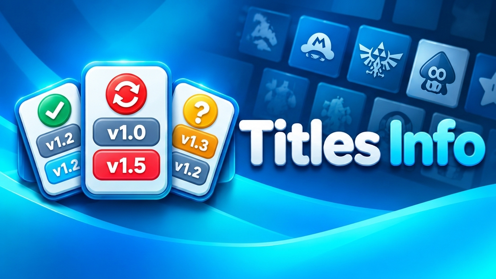
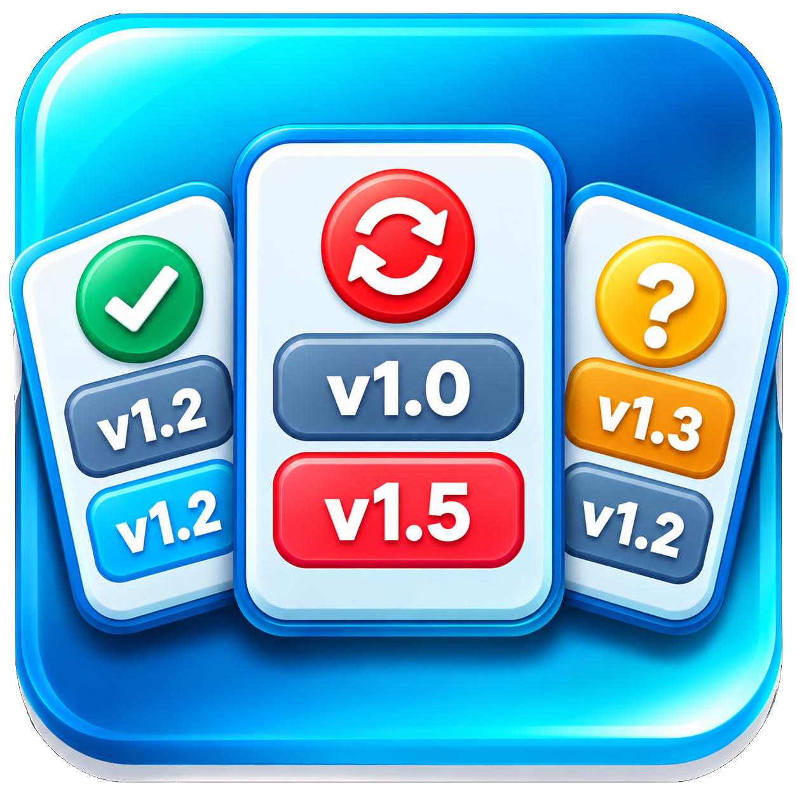

# Titles Info

<p align="center">
  
</p>

<p align="center">
  
</p>

**Titles Info** is a native homebrew application for the Nintendo Wii U (Aroma). It enumerates installed titles and presents them in a navigable on-screen list, including localized title names, title identifiers, product codes, region flags, title type, installed version, a version-status preview, title icon and storage location. The project is written in C++ and uses WUT, MCP/ACP, Mocha and SDL2.

> **Offline database:** `Latest`, `Notes` and known region values are read from a precompiled local JSON database derived from WiiUBrew. Titles Info does not access the Internet. If a corresponding UPDATE record exists, its version is used as `Latest` for the base GAME until that UPDATE is installed. Unknown or potentially stale version data is shown as uncertain rather than treated as a confirmed update result.

**Version 1.0:** adds Title-ID-based GAME/UPDATE version comparison, hides the base GAME row when its UPDATE is installed, and displays a dedicated round indicator for up-to-date, update-available and uncertain version states.

## Screenshots

<p align="center">
  
</p>

<p align="center">
  
</p>

<p align="center">
  
</p>

<p align="center">
  
</p>

<p align="center">
  
</p>

<p align="center">
  
</p>

## Features

- Enumerates installed titles through MCP and reads installed-title metadata through ACP and the mounted title volumes.
- Displays the localized long title name where available, then falls back to `longname_en`, `shortname_en`, and finally the Title ID.
- Reads the Wii U system language from `/vol/system/config/system.xml`; if the language cannot be read or recognized, English is used as the fallback.
- Decodes common XML/HTML entities in metadata text, including `&amp;`, `&apos;`, `&quot;`, `&lt;`, `&gt;`, decimal numeric entities and hexadecimal numeric entities, so names display their intended characters.
- Shows Title ID, Product Code, a concise `Notes` description from the local database (or `Wii Game` / `Wii U Game` fallback), and a title-kind label such as `GAME`, `VIRTUAL CONSOLE`, `UPDATE`, `DLC`, `WII` or `SYSTEM/OTHER`.
- Displays a region flag using embedded textures: ALL/region-free, EUR, USA, JAP, EUR/USA, EUR/JAP or JAP/USA. Unknown or missing region metadata falls back to ALL.
- Loads each title's icon from its installed `meta/iconTex.tga`.
- Displays installed storage (`USB` or `NAND`) between the region flag and the title-kind label. The top-bar `ALL` / `USB` / `NAND` controls retain their existing layout.
- Displays a round version-status indicator using the embedded PNG assets `resources/updated.png` (green/white check), `resources/update.png` (red/white update arrow) and `resources/unknown.png` (yellow/white question mark). The images are used for confirmed up-to-date, update-available and uncertain states respectively; the version-status decision rules are unchanged.
- Compares installed versions against the highest known database version. When a GAME has a matching UPDATE record, that UPDATE version supplies `Latest`; if the UPDATE is installed, only the UPDATE row is shown. Missing version metadata, untrusted database metadata, and an installed version above the database value all produce the yellow uncertain status.
- Filters the list by all supported titles, USB or NAND. A `NONE` preview filter is available in debug builds only.
- Searches by title name or Title ID using the Wii U native software keyboard.
- Supports selection, row-by-row navigation, page navigation and rescanning the installed title list.
- Uses incremental loading both at startup and during manual refresh: the empty UI and refresh indicator are presented before title enumeration begins, then the list appears when loading finishes.
- Caches rendered text and font instances to avoid rebuilding the same UI resources every frame.
- Emits diagnostic messages through `OSReport` and UDP logging.

System titles and other Title ID namespaces outside the repository's configured relevant-title set are excluded from the user-facing list. Storage usage is not displayed. Database `Notes` are summarized when the database is generated on a PC; the Wii U application only reads the finished text and applies the simple fallback when a note is empty.

## Controls

| Wii U control | Action |
|---|---|
| D-pad Up / Down | Move the selection to the previous / next title |
| L / R | Move the selection up / down by one page |
| X | Refresh/rescan installed titles |
| Y | Open the native search keyboard; search by name or Title ID |
| ZL / ZR | Cycle through the available storage filters |
| HOME | Exit the application |

The debug build includes an additional `NONE` filter for checking the empty-list UI and synthetic Zelda title cards that exercise up-to-date, update-available, missing-latest, installed-newer-than-database, and untrusted-metadata states. The debug cards alternate between NAND and USB and are recreated after refresh; they do not depend on the titles installed on the console. The release filter cycle contains `ALL`, `USB` and `NAND` only. In the top bar, unselected filter buttons use a white background with blue text; the selected filter uses a turquoise background with black text.

## Project structure

```text
TitlesInfo/
├── Makefile                    # WUT build rules, embedded resources and WUHB packaging
├── README.md
├── docs/
│   ├── banner.png               # README banner preview
│   └── icon.png                 # README application icon
├── fonts/
│   └── DejaVuSans.ttf           # Font embedded into the executable
├── include/
│   ├── DebugConfig.hpp          # __DEBUG__ and __DEBUG_HEARTBEAT__ switches
│   ├── InputHandler.hpp         # Input state declarations
│   ├── Log.hpp                  # OSReport and UDP logging helper
│   ├── SearchKeyboard.hpp       # Native keyboard integration
│   ├── TitleDatabase.hpp        # JSON database loading and title metadata lookup
│   ├── TitleRepository.hpp      # Installed-title model and repository interface
│   └── UserInterface.hpp        # SDL UI and rendering declarations
├── meta/
│   ├── iconTex.tga              # WUHB application icon
│   ├── bootTvTex.tga            # TV splash image
│   └── bootDrcTex.tga           # GamePad splash image
├── resources/
│   ├── title_database.json      # Complete bundled offline database
│   ├── ZL.png / ZR.png          # Control graphics
│   ├── unknown.png              # Uncertain version status (yellow question mark)
│   ├── update.png               # Update available (red update arrow)
│   ├── updated.png              # Up to date (green check mark)
│   └── flag_*.png               # ALL, EUR, USA, JAP and combined-region flags
├── source/
│   ├── main.cpp                 # Startup, main loop, refresh workflow and shutdown
│   ├── InputHandler.cpp         # VPAD input polling
│   ├── SearchKeyboard.cpp       # SDL/Wii U software-keyboard event handling
│   ├── TitleDatabase.cpp        # Small built-in JSON reader, SD override and metadata application
│   ├── TitleRepository.cpp      # MCP enumeration, ACP/XML metadata, title kind and region
│   └── UserInterface.cpp        # SDL2/SDL_ttf rendering, capsules and resource caches
└── build/                       # Generated objects and final build artifacts
```

`build/` is generated by the Makefile and does not need to be committed. `fonts/` and `resources/` are included in the build's `DATA` inputs; WUT's `bin2o` rules embed the PNG, TTF and JSON resources so the application can run without loose resource files. The WUHB package uses the three TGA files under `meta/` for its icon and TV/GamePad splash images. After a successful build, the Makefile creates `build/release/` and copies `TitlesInfo.wuhb` plus `title_database.json` there.

## Requirements

Use the devkitPro MSYS shell on Windows (or a compatible devkitPro environment) with:

- devkitPro and devkitPPC
- WUT (Wii U Toolchain)
- Wii U SDL2 libraries: `wiiu-sdl2`, `wiiu-sdl2_image` and `wiiu-sdl2_ttf`
- `libmocha`
- WUT's `wuhbtool`, `elf2rpl` and `bin2o` build utilities

The Makefile also links the SDL image/font dependencies used by the installed Wii U portlibs, including FreeType, HarfBuzz, PNG, JPEG and WebP support. Install these through the appropriate devkitPro package setup rather than copying host Windows libraries into the Wii U toolchain.

## Build

Open the **devkitPro MSYS** shell, change to the project root and run:

```sh
make clean
make
```

If the Makefile/environment does not provide `make clean`, remove the generated `build/` directory before rebuilding. The Makefile creates `build/` for intermediates and compiler outputs. Expected outputs include:

- `build/TitlesInfo.elf`
- `build/TitlesInfo.rpx`
- `build/TitlesInfo.wuhb`
- `build/release/TitlesInfo.wuhb`
- `build/release/title_database.json`

For Aroma, copy `build/release/TitlesInfo.wuhb` to `sd:/wiiu/apps/`. The external JSON is optional: create `sd:/wiiu/apps/TitlesInfo/` if it does not exist, then copy `build/release/title_database.json` to `sd:/wiiu/apps/TitlesInfo/title_database.json` if you want the app to use that file instead of the database embedded in the WUHB. The external file is used only if it passes validation; otherwise Titles Info falls back to its embedded database.

### Debug switches

The project-wide switches are in `include/DebugConfig.hpp`:

```cpp
#ifndef __DEBUG__
#define __DEBUG__ 1
#endif

#ifndef __DEBUG_HEARTBEAT__
#define __DEBUG_HEARTBEAT__ 0
#endif
```

- Set `__DEBUG__` to `0` to disable debug-only UI functionality, including the `NONE` filter. Check the Makefile/compiler flags too: a command-line `-D__DEBUG__` definition may override the intended configuration.
- Set `__DEBUG_HEARTBEAT__` to `1` to enable the main-loop heartbeat log. When enabled, it logs the first iteration and then every 60 loop iterations; this is not guaranteed to mean 60 messages per second. The default `0` excludes the heartbeat counter/logging code.
- `main.cpp` includes `DebugConfig.hpp` directly so it does not depend on another header to include the debug configuration indirectly.

## Updating the offline database with an LLM

The database is intentionally offline at runtime. To update it, generate a new `title_database.json` on a PC and replace the external file on the SD card, or rebuild Titles Info to embed the updated database in a new WUHB.

### 1. Save the WiiUBrew source page

1. Open <https://wiiubrew.org/wiki/Title_database> in a desktop browser.
2. Save the page using the browser's **Save Page As** command, preferably as **Webpage, HTML only** (a complete webpage archive/ZIP that contains the `.html`/`.htm` file is also acceptable).
3. Attach that saved HTML file or ZIP to the LLM conversation together with the prompt below.

A saved copy is required because the page contains many separate tables and thousands of records. Live web access may be unavailable, blocked, incomplete, or return only a subset of the page. Requiring the actual saved page gives the LLM a concrete source to inspect and makes it possible to check that all relevant records were processed. **If the saved page is not attached, the LLM must ask you to attach it and must not fabricate or guess a “complete” database.**

### 2. Copy this prompt into an LLM

Attach the saved HTML page (or its ZIP) before submitting this prompt. The prompt deliberately requires the source snapshot instead of relying on the LLM's live browsing.

```text
You are generating a complete offline JSON database for the Nintendo Wii U homebrew application "Titles Info".

SOURCE REQUIREMENT — READ FIRST
- You must use the user-attached saved HTML copy of https://wiiubrew.org/wiki/Title_database, or a ZIP containing that saved HTML file.
- If no saved HTML/ZIP is attached, STOP and ask the user to attach it. Explain that the page contains many tables and thousands of records, and live web access can be unavailable or incomplete; without the actual snapshot you cannot reliably guarantee a complete database.
- Do not claim to have processed the source if you cannot open/read the attachment. If the ZIP contains browser support files, locate and parse the main .html/.htm page.
- Do not rely on live browsing as a substitute for the attached snapshot. Do not invent, infer, or fabricate missing Title IDs, regions, notes, or versions.

GOAL
Produce a complete, valid UTF-8 JSON file named exactly:
title_database.json

SCOPE AND COMPLETENESS
- Parse every relevant table in the saved page, not only the first table or the first few results.
- Include valid 16-hex-digit Wii U Title IDs, normalizing them to uppercase and removing hyphens.
- Include the relevant Wii U title namespaces:
  00050000 (base titles), 00050002 (Virtual Console namespace),
  0005000C (DLC), and 0005000E (updates).
- Merge duplicate rows with the same normalized Title ID into one record.
- Do not silently truncate the source or stop after an arbitrary number of rows.
- Report the number of unique records processed and any source rows that could not be interpreted. Never describe the result as complete if the entire attached source could not be processed.

OUTPUT SCHEMA
Return a JSON object with this structure:
{
  "schemaVersion": 1,
  "source": "WiiUBrew Title database",
  "sourceUrl": "https://wiiubrew.org/wiki/Title_database",
  "titles": [
    {
      "titleId": "0005000010144F00",
      "notes": "Concise one-line summary",
      "region": "EUR",
      "latestVersion": 64
    }
  ]
}

FIELD RULES
1. titleId
   - Exactly 16 uppercase hexadecimal characters, no hyphens or spaces.
   - It is a string, never a JSON number, so leading zeroes are preserved.
   - Sort the final titles array by titleId in ascending lexicographic order.
   - Include each normalized Title ID only once.

2. notes
   - Produce the final concise, meaningful, single-line text during database generation. The Wii U app must not summarize, interpret, shorten, or truncate source notes.
   - ABSOLUTE LENGTH LIMIT: every non-empty notes value MUST contain at most 58 characters, counting spaces and punctuation. This is a strict maximum, not a target. Validate the character count of every record before writing the output; no record may exceed 58 characters.
   - Preserve useful subregion information and supported-language information whenever present. Examples include Scandinavia and explicit language lists such as English, French, German, Spanish, Italian, Dutch, Swedish, Norwegian, Danish, and Finnish. If needed to stay within 58 characters, use concise, unambiguous language names or standard language abbreviations, but do not omit meaningful subregion information.
   - Summarize the source note faithfully. Prefer information that helps a user understand the title, such as a regional/language variant, Virtual Console platform, collection, homebrew forwarder, or unreleased status.
   - Remove irrelevant technical speculation, Title-ID encoding trivia, and verbose version-history details when they do not help describe the title.
   - Never meet the limit by blindly cutting a string mid-word. Rewrite it as a shorter meaningful summary; only use an ellipsis if it is genuinely useful and the total still remains at most 58 characters.
   - Never invent a language, subregion, product detail, or description.
   - If the source Notes field is empty or contains no useful user-facing information, use the empty string "". Titles Info will display "Wii Game" for a title classified by local Wii U metadata as Wii-mode, or "Wii U Game" otherwise.

3. region
   - Normalize known regions to one of: "ALL", "EUR", "USA", "JPN", "EUR/USA", "EUR/JPN", "JPN/USA".
   - Accept source aliases such as "JAP" as "JPN" and normalize combined-region ordering to the supported forms above.
   - If the source has no reliable region or its region cannot be represented by these values, use JSON null. Do not guess.
   - Where the source explicitly describes region changes by version, use the region applicable to the latest listed version only when that is unambiguous; otherwise use null.

4. latestVersion
   - Read the Versions/Version field and select the highest numeric Wii U title version from tokens such as v0, v16, v64, v128.
   - Ignore suffixes such as _DEV when extracting the numeric version. Do not confuse a game version like 2.03 with a Wii U title version unless the source clearly identifies it as a title-version token.
   - Store the result as a JSON integer from 0 to 65535.
   - If no numeric title version can be established reliably, use JSON null. Never use the installed version from a console as a substitute.

VALIDATION
- The output must be strict JSON: double-quoted property names and strings, no comments, no trailing commas, no Markdown fences around the JSON file itself.
- Every record must contain all four fields: titleId, notes, region, latestVersion.
- Validate all Title IDs, region values, version ranges, duplicate IDs, and the Notes length limit. Every non-empty notes string must be a single line of 58 characters or fewer, counting spaces and punctuation. If any note exceeds 58 characters, revise its summary and validate again before returning the file.
- Keep the full database in the output file; do not replace it with examples, a summary, a partial list, or an ellipsis.
- Do not change the schema version unless the user explicitly asks for a schema change.
- Prefer creating/attaching the generated title_database.json file. In your response, report the number of unique records, any skipped/uninterpretable rows, and any limitations honestly.
```

### 3. Validate and install the generated file

1. Check that the LLM returned an actual `title_database.json` file, not a shortened JSON example in the chat.
2. Keep a backup of the existing file before replacing it.
3. For use without rebuilding, copy the new file to `sd:/wiiu/apps/TitlesInfo/title_database.json`. Titles Info validates the external JSON and falls back to the embedded copy if the external file is missing or invalid.
4. To include the updated database in the distributed WUHB, replace `resources/title_database.json` in the source tree and run `make clean` followed by `make`. The successful build will copy both `TitlesInfo.wuhb` and `title_database.json` into `build/release/`.

## Implementation notes

### Installed-title discovery and classification

- `TitleRepository` uses `MCP_Open`, `MCP_TitleCount` and `MCP_TitleList` to enumerate installed titles.
- The repository currently considers Title ID high-word namespaces `00050000` (base Wii U titles), `00050002` (Virtual Console namespace), `0005000E` (updates) and `0005000C` (DLC) relevant for the list.
- Classification combines the Title ID namespace with MCP `appType` and the `content_platform` metadata where available. This lets the application retain its desired labels (`GAME`, `VIRTUAL CONSOLE`, `UPDATE`, `DLC`, `WII`, `SYSTEM/OTHER`) while using `appType` to identify Wii-mode titles. This is still an area to validate against a broad set of real installed titles: Virtual Console subtypes and unusual title metadata may need additional handling.
- `groupId` is available in MCP title-list metadata and can help relate titles, but it is not a globally unique game identifier and should not be used alone to associate a base game, update and DLC.
- MCP supplies fields such as `titleId`, `groupId`, `path`, `appType`, `titleVersion`, `osVersion`, `sdkVersion` and `indexedDevice`. The app currently uses the fields needed for discovery, classification, installed version and storage, rather than displaying every MCP field.
- It initializes Mocha and attempts to mount `storage_usb01` and `storage_mlc01` before reading title metadata and icons. A mount failure is logged and may make metadata or icons for that volume unavailable.
- NAND/USB classification is derived from MCP's `indexedDevice` value.
- The title list is sorted by name, with Title ID as a tie-breaker. `X` releases cached title graphics and reloads the list using incremental steps.

### Metadata, localization and region flags

- Title names prefer the `longname_*` field matching the Wii U system language. Supported language tags include Japanese (`ja`), English (`en`), French (`fr`), German (`de`), Italian (`it`), Spanish (`es`), Simplified Chinese (`zhs`), Korean (`ko`), Dutch (`nl`), Portuguese (`pt`), Russian (`ru`) and Traditional Chinese (`zht`).
- If the localized long name is absent, the fallback order is `longname_en`, `shortname_en`, ACP-provided localized/English metadata where available, then the Title ID.
- The system-language reader consults `/vol/system/config/system.xml`. This path and field format should be validated on the target console; if the value cannot be read or normalized, English is used.
- Product Code is read from the installed title's `meta/meta.xml` (`product_code`) and shown as `N/A` if absent.
- Region is read from `meta.xml` and interpreted as a bitmask: Japan `0x1`, USA `0x2`, Europe `0x4`, combinations `0x6` (EUR/USA), `0x5` (EUR/JAP), `0x3` (JAP/USA), and region-free/all regions `0xFFFFFFFF`. Missing, unknown or unsupported values fall back to `flag_ALL.png`.
- Flag texture mapping: `flag_ALL.png`, `flag_EUR.png`, `flag_USA.png`, `flag_JAP.png`, `flag_EUR_USA.png`, `flag_EUR_JAP.png` and `flag_JAP_USA.png`. Combined-region flags intentionally cover both orderings (for example EUR/USA and USA/EUR).
- XML entity decoding handles named entities commonly used in title names and numeric decimal/hexadecimal entities. This is important because metadata text may otherwise show literal strings such as `&amp;` or `&apos;`.

### Offline database and UI metadata

- `resources/title_database.json` is the full initial database bundled with the source and embedded into the WUHB during compilation.
- The database contains records for the relevant Wii U Title ID namespaces: `00050000`, `00050002`, `0005000C` and `0005000E`. The initial file generated from the supplied saved WiiUBrew HTML snapshot contains 4,639 unique Title IDs.
- Each record contains `titleId` (16 uppercase hexadecimal characters without hyphens), `notes` (a preprocessed single-line summary of at most 58 characters, counting spaces and punctuation, or an empty string), `region` (a normalized supported region or `null`) and `latestVersion` (the highest recognized numeric `vN` version or `null`).
- The application first tries `sd:/wiiu/apps/TitlesInfo/title_database.json`. A valid external file overrides the embedded database. If the file is absent or invalid, the embedded database is used. No Internet access, curl library, network button or runtime note summarization is used.
- Database region takes precedence over local `meta.xml` region when a known database region is present. If the database has no recognized region, the local region remains in use.
- The `Notes` summary is prepared when the database is generated on a PC. It should preserve meaningful subregion and supported-language information. Empty notes are displayed as `Wii Game` for Wii-mode titles and `Wii U Game` for other title kinds.
- `Latest` comes from the database. For a GAME, a matching `0005000E` UPDATE record takes precedence when available. An installed UPDATE replaces its associated GAME row in the visible list. If the matching UPDATE record has `latestVersion: null`, `Latest: N/A` uses the existing red palette and `Installed` uses the existing yellow/amber warning palette. The same warning colors are used when the installed version exceeds the database value, since the database may be stale. No new colors are introduced.
- The JSON reader is included in `source/TitleDatabase.cpp`; it has no external JSON-library dependency. The parser validates the schema, title IDs, fields and duplicate IDs before accepting a database.

### Version-status indicator assets

- Replaced the procedurally drawn round version-status symbols with the supplied PNG images in `resources/`: `updated.png`, `update.png` and `unknown.png`.
- The three PNG resources are embedded by the existing Makefile resource rules; no change to the Makefile or the top-bar `ALL` / `USB` / `NAND` controls was required.
- The existing status logic remains unchanged: green for a trusted up-to-date result, red for a trusted available update, and yellow when the comparison is uncertain.
- The indicator textures are released during UI shutdown. A devkitPro build and on-console visual check are still required to validate the final release.

### Optimization and code maintenance

- Reused rendered controller-glyph textures through a dedicated cache, avoiding repeated SDL surface rendering and texture creation/destruction on every frame. Cached glyph textures are released during UI shutdown.
- Normalized the search query once per filtering pass instead of once for every title, and moved the filtered-title count calculation out of idle main-loop frames so it runs only when downward navigation needs an upper bound.
- Removed unused repository/UI APIs and state (`TitleRepository::Load`, `UserInterface::Renderer`, the unused icon-loader declaration, and unused stored VPAD status) along with unused color constants and includes. The active incremental loading lifecycle remains unchanged.
- Replaced repeated front-of-string erasure when trimming metadata values with a single whitespace-range calculation.
- These changes are code-level optimizations; runtime performance has not yet been measured on the Wii U, and this version still requires a devkitPro build and console validation.

### Diagnostics and lifecycle

- Startup initializes ProcUI, UDP logging, VPAD, Mocha, storage mounts, ACP, SDL UI and the native keyboard without enumerating titles during UI initialization. It presents the empty list and refresh indicator before loading titles incrementally. Shutdown releases title graphics and finalizes those subsystems.
- Logs are sent through `OSReport` and UDP logging. The current logging helper does not create a `session.log` file on the SD card.
- `__DEBUG_HEARTBEAT__` is independent of `__DEBUG__`, so the UI debug filter can remain enabled while heartbeat logs stay disabled.

## Wii U build and device-testing notes

The project was brought up against a working devkitPro/WUT setup rather than assuming the toolchain itself was broken. The following issues and decisions were relevant during development:

1. **Use the devkitPro MSYS environment.** Build with the Wii U toolchain and its headers/libraries, not a normal Windows host compiler. A host build failed on Wii U/Windows-specific headers and is not a valid test of the target build.
2. **Resolve Wii U SDL and Mocha dependencies explicitly.** Missing SDL image/font headers and libraries had to be addressed. `libmocha` was built/installed into the WUT environment using the dependency setup procedure. The Makefile links the Wii U-target libraries, not desktop SDL binaries.
3. **Keep resource paths and build outputs consistent.** The font lives in `fonts/`, controls and flags live in `resources/`, documentation images live in `docs/`, and generated objects plus `.elf`/`.rpx`/`.wuhb` outputs belong in `build/`. Embedding resources through WUT's `bin2o` rules avoids missing-resource-object errors.
4. **Avoid path assumptions involving spaces.** Build from the devkitPro MSYS shell and preserve the Makefile's project-root/build-directory layout; Windows paths translated into MSYS paths can otherwise make build rules harder to diagnose.
5. **Compare against a known-good homebrew before reinstalling the toolchain.** The official WUT Hello World sample previously hung on the console, while `TitleUninstaller` compiled and launched successfully with the same installed toolchain. That evidence pointed toward isolating startup/lifecycle and sample-specific behavior instead of immediately reinstalling devkitPro/WUT.
6. **Fix character escapes in C++ carefully.** A malformed ` '\\0' ` multi-character literal caused `-Wmultichar` and `-Wtype-limits` warnings. The correct null-character literal is `'\0'`.
7. **Validate on the actual console.** A successful compile is not sufficient: test the generated WUHB on the Wii U, and use UDP logs to identify the last successful startup step if the application hangs or exits unexpectedly. The application has previously been reported to launch on the console, but each meaningful change should still be tested.

## Startup splash and music

The WUHB package includes `meta/bootTvTex.tga` and `meta/bootDrcTex.tga` as TV and GamePad splash images. During testing, the usual startup/loading music was observed not to play when the application was packaged with a splash/banner image. **Titles Info itself does not currently include or play music or other audio.** The splash images are visual assets only; this README records the observed behavior, but does not claim that the images are definitively the cause of the system's startup-music behavior.

## Current limitations and next steps

- The bundled database is a snapshot of the WiiUBrew page supplied when the database was prepared; it can become stale after release.
- Some source records do not list a region or numeric version. Those values remain unknown rather than being guessed.
- Virtual Console and unusual/Wii-mode title classification must continue to be validated against real installed titles, especially where Title ID namespace, `appType` and content-platform metadata may overlap.
- The system-language XML path and value format should be confirmed on the target console; English fallback is used if reading or normalization fails.
- Product Code and region depend on metadata being present and readable from the mounted title volume.
- Storage capacity/usage is intentionally omitted.
- The application has no in-app music or audio playback.
